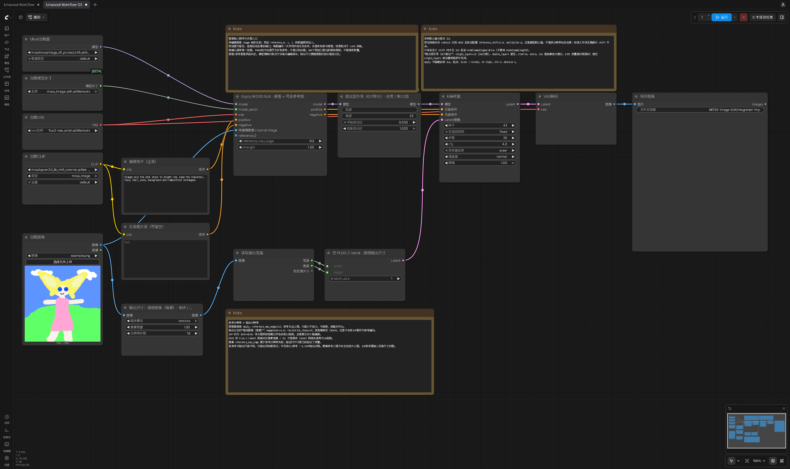
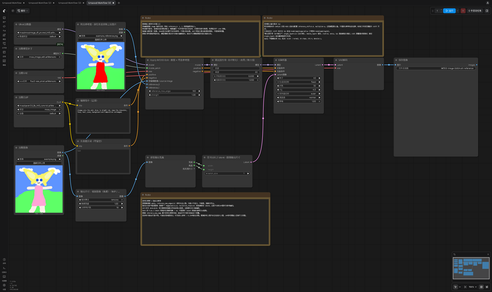

# 标准工作流

**简体中文** · [English](README.en.md) · [返回项目说明](../README.md)

下载 JSON 或含工作流的原始 PNG，拖入 ComfyUI。请先安装本分支节点、通过 `install.py` 检查，再重启 ComfyUI；已验证核心为 v0.42.3。选择本机的底模、TE、VAE 和 Edit 补丁。补丁放在 `models/model_patches/`，无需预先合并。

- 输入示例：[example.png](example.png)、[example_reference.png](example_reference.png)。下载后，在对应的 Load Image 节点上传；导入 JSON 不会自动上传图片。第一张是 ComfyUI 示例图，第二张是生成的红裙参考图。
- 默认参数：参考图长边上限 512，输出约 1MP，像素宽高对齐 16，30 步，CFG 4，Euler / normal。原生 MOSS 自动设置 shift 5.0；工作流中已显示 SLG 第 22 层的设置。
- 单图推荐使用 SFT；Base 仅作为对照。多图接口可实际推理，当前 LoRA 的多图质量仍需评估。
- 模型名称是示例，按本地文件重新选择；不需要采用相同子目录。
- [查看完整参数说明](../README.md#完整工作流)。

## SFT 单图编辑

[工作流 JSON](../workflows/moss_edit_single_reference.json) · [API JSON](../workflows/moss_edit_single_reference.api.json) · [完整 PNG](moss_edit_single_reference.png)

## Base 对照

[工作流 JSON](../workflows/moss_edit_base_bf16.json) · [API JSON](../workflows/moss_edit_base_bf16.api.json) · [完整 PNG](moss_edit_base_bf16.png)

## 多图编辑

[工作流 JSON](../workflows/moss_edit_multi_reference.json) · [API JSON](../workflows/moss_edit_multi_reference.api.json) · [完整 PNG](moss_edit_multi_reference.png)

